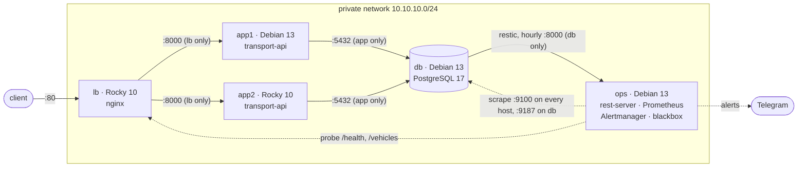
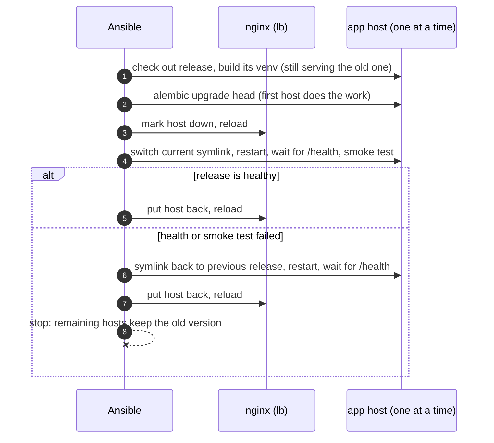

# ansible-infra

[](https://github.com/DYyyyDYyy/ansible-infra/actions/workflows/ci.yml)

A small production setup on five virtual machines, built and updated by Ansible.
`make up` turns empty Debian and Rocky Linux VMs into a hardened stack serving my
[transport-firm REST API](https://github.com/DYyyyDYyy/rest-api-transport-firm)
behind a load balancer, with hourly backups and alerting. `make deploy` ships a
new version one server at a time without dropping a single request, and rolls
back by itself if the new version is broken.

## What it shows

- **Idempotent configuration management.** A second run of the playbook reports
  `changed=0` on every host; CI fails if it does not.
- **Zero-downtime rolling deploys.** Each app server is drained from nginx,
  switched, health-checked and put back. In the docker lab, 1900 requests
  were sent during a full deploy and none failed.
- **Automatic rollback.** If a new release fails its health or smoke test, the
  host goes back to the previous release and the rollout stops before it
  reaches the other server.
- **Two distro families.** Every role runs on Debian 13 and Rocky Linux 10,
  with SELinux left enforcing on Rocky.
- **Backups that are proven to restore.** Hourly `pg_dump` into restic on a
  separate host whose rest-server is append-only, so a compromised database
  server cannot delete old backups. `make restore-test` restores the latest
  snapshot into a scratch database and compares the row count of every
  table with the live one, in CI.
- **Monitoring with tested alerts.** Prometheus, Alertmanager (to Telegram),
  node, PostgreSQL and blackbox exporters, targets generated from the
  inventory. Every alert rule has a `promtool` unit test, and
  `make alert-test` breaks the app on purpose and waits for the alerts in
  Alertmanager.
- **Defence in depth.** nftables default-deny with rules derived from the
  inventory, key-only SSH, automatic security updates, secrets in Ansible
  Vault, and every service sandboxed by systemd under its own account
  (the app cannot modify its own code; the backup job can read the
  database but not write to it).
- **Tested infrastructure.** Molecule and testinfra for every role on both
  distros, plus end-to-end tests of the whole stack in CI.

## Architecture



| Host | Role(s) | Open ports |
|---|---|---|
| `lb` | `common`, `firewall`, `node_exporter`, `nginx` | 22, 80 |
| `app1`, `app2` | `common`, `firewall`, `node_exporter`, `app` | 22, 8000 from `lb` only |
| `db` | `common`, `firewall`, `node_exporter`, `postgresql`, `postgres_exporter`, `backup` | 22, 5432 from `app*` only, 9187 from `ops` only |
| `ops` | `common`, `firewall`, `node_exporter`, `restic_server`, `monitoring` | 22, 8000 from `db` only |

Every host also opens 9100 (node_exporter) to `ops` only. Prometheus (9090),
Alertmanager (9093) and blackbox_exporter (9115) listen on `127.0.0.1` on
`ops` and are not reachable from the network at all.

`ops` is a fifth machine on purpose: a backup on the server it protects is
not a backup, and monitoring should not go down with what it watches.

**Demo:** [`docs/demo.cast`](docs/demo.cast), a 2-minute terminal recording
of `make zero-downtime` in the docker lab: a rolling deploy while `curl`
hits the load balancer every 20 ms, ending in `requests: 1852   failed: 0`.
Play it with `asciinema play docs/demo.cast` (`uv tool run asciinema play
docs/demo.cast` works without installing anything).

## Quick start

Requirements: Linux with KVM, `libvirt`, `vagrant` with the `vagrant-libvirt`
plugin, `make`, [`uv`](https://docs.astral.sh/uv/) and about 5 GB of free RAM.
Everything else (ansible-core, collections, linters, Molecule) is pinned and
installed into `.venv` by `make venv`.

```bash
make up                     # 5 VMs + site.yml
curl http://10.10.10.10/health
curl http://10.10.10.10/vehicles

make deploy VERSION=def475af343b98ff25ab5b253d328745f3378a20   # rolling deploy of a commit
make check-idempotence      # re-run site.yml, fail on any change
make zero-downtime          # deploy under load, fail on any non-200 response
make test-rollback          # deploy a release that fails its smoke test
make restore-test           # back up now, restore into a scratch DB, compare rows
make alert-test             # stop the API and an exporter, expect the alerts
make down
```

No libvirt? The same stack runs in systemd containers:

```bash
make up ENV=docker          # needs only the docker daemon
curl http://127.0.0.1:8080/health
make e2e                    # what CI runs: up, idempotence, deploys, restore, alerts
```

`make help` lists all targets.

## How a deploy works



Details and trade-offs: [ADR 3](docs/adr/0003-rolling-deploy-and-backward-compatible-migrations.md).

## Roles

| Role | What it does |
|---|---|
| [`common`](roles/common) | Base packages, admin users with exclusive SSH keys, sudo (validated with `visudo`), hardened `sshd` drop-in (validated with `sshd -t`), unattended-upgrades or dnf-automatic for security updates |
| [`firewall`](roles/firewall) | nftables default-deny ruleset from variables, checked with `nft -c`, reloaded atomically; masks firewalld on Rocky |
| [`postgresql`](roles/postgresql) | Distro PostgreSQL (17 on Debian, 16 on Rocky), settings in `conf.d/`, templated `pg_hba.conf`, users with SCRAM passwords, databases |
| [`app`](roles/app) | The FastAPI service: release directories with a venv each, `current` symlink, Alembic migrations, systemd unit with sandboxing, health and smoke checks, old release cleanup, rollback tasks |
| [`nginx`](roles/nginx) | Reverse proxy and round-robin load balancer with passive health checks, a shared upstream zone and drainable backends |
| [`node_exporter`](roles/node_exporter) | Host metrics on every machine, textfile collector for metrics written by other jobs |
| [`postgres_exporter`](roles/postgres_exporter) | PostgreSQL metrics; peer auth over the Unix socket as a `pg_monitor` role, so no password exists |
| [`restic_server`](roles/restic_server) | rest-server in append-only mode with bcrypt logins and private repositories; server-side retention (`forget --prune`, `check`) on a timer |
| [`backup`](roles/backup) | Hourly `pg_dump` into restic as a read-only database role, first snapshot on provisioning, freshness metric for Prometheus |
| [`monitoring`](roles/monitoring) | Prometheus with targets from the inventory, alert rules with unit tests, Alertmanager (Telegram or nothing), blackbox HTTP probes |
| [`upstream_binary`](roles/upstream_binary) | Helper: downloads a release tarball once on the controller, checks its pinned SHA256, unpacks it into `/opt/<name>-<version>` |

Exporters, Prometheus, Alertmanager and rest-server are upstream releases
pinned by version and SHA256 ([ADR 7](docs/adr/0007-prometheus-monitoring-from-upstream-binaries.md)):
the same binary on both distros, no `latest` anywhere. restic itself comes
from the Debian repositories, so `backup` and `restic_server` declare Debian
only ([ADR 6](docs/adr/0006-backups-with-restic-to-an-append-only-rest-server.md)).

The distro differences (package names, PostgreSQL paths and `initdb`, the
nginx user, the nftables config path, SELinux) live in each role's
`vars/<os_family>.yml`; the tasks are shared.

## Testing

| Level | Tool | Where |
|---|---|---|
| Lint | `yamllint`, `ansible-lint` (production profile), `shellcheck` | `make lint` |
| Role | Molecule + testinfra in systemd containers, Debian 13 and Rocky 10, including an idempotence run | `make test`, CI matrix: 10 roles, 18 jobs |
| Config | `promtool check config/rules`, `amtool check-config`, `nginx -t`, `nft -c`, `sshd -t`, `visudo -c` before any file is written | every converge |
| Alert rules | `promtool test rules`: synthetic series in, expected alerts out | every converge of `monitoring` |
| Stack | full `site.yml` on the docker lab, second run must be `changed=0` | `make check-idempotence` |
| Deploy | rolling deploy while `curl` hits the load balancer every 20 ms | `make zero-downtime` |
| Failure | release whose smoke test fails: expect rollback, hosts back in nginx, no failed requests | `make test-rollback` |
| Backup | seed data, back up, restore into a scratch database, compare `count(*)` of every table | `make restore-test` |
| Alerting | stop the API and postgres_exporter, wait for `AppEndpointDown` and `InstanceDown` in Alertmanager, recover | `make alert-test` |

Results from local runs (2026-11-11, docker lab from a fresh clone and the
five Vagrant VMs):

| Check | Docker lab | Vagrant VMs (SELinux enforcing) |
|---|---|---|
| Molecule | 10 roles, 18 role × distro runs, all green with idempotence | — |
| Second `site.yml` run | `changed=0` on all 5 hosts | `changed=0` on all 5 hosts |
| Rolling deploy under load | 1900 requests, 0 failed, slowest 106 ms | 1154 requests, 0 failed, slowest 43 ms |
| Failed deploy with rollback | 1151 requests, 0 failed, both hosts on the previous release | 695 requests, 0 failed, both hosts on the previous release |
| Restore test | 8 tables, 22 rows, identical to the live database | 8 tables, 22 rows, identical |
| Alert test | `AppEndpointDown` and `InstanceDown` active, then resolved | same |
| SELinux | n/a in containers | Enforcing, 0 AVC denials; nginx in `httpd_t`, services in `unconfined_service_t` |
| Full `make e2e` | 17 minutes | — |


## Backups

Every hour `backup.timer` on `db` runs `pg_dump` through restic into the
repository on `ops`. Snapshots are encrypted on `db`; `ops` only stores
ciphertext and refuses deletes from clients. Retention (24 hourly, 7 daily)
runs on `ops`. To restore a single table, see the
[runbook](docs/runbooks/restore-dropped-table.md).

```bash
make restore-test                         # proves the latest snapshot restores
vagrant ssh db -c 'sudo systemctl list-timers backup.timer'
vagrant ssh db -c 'sudo sh -c "set -a; . /etc/restic/backup.env; restic snapshots"'
```

## Monitoring

The web UIs listen on localhost on `ops`. Open an SSH tunnel (local
forwarding is allowed on `ops` only) and browse to
<http://localhost:9090> (Prometheus) and <http://localhost:9093>
(Alertmanager):

```bash
ssh -i .vagrant/machines/ops/libvirt/private_key \
    -L 9090:127.0.0.1:9090 -L 9093:127.0.0.1:9093 -N vagrant@10.10.10.14
```

In the docker lab, query the API from inside the container instead:
`docker exec lab-ops curl -s localhost:9093/api/v2/alerts`.

**Telegram alerts.** Without a bot token, alerts are only visible in
Alertmanager. To get them on your phone:

1. Message [@BotFather](https://t.me/BotFather), send `/newbot`, and copy
   the token it gives you.
2. Send any message to your new bot, then open
   `https://api.telegram.org/bot<token>/getUpdates` and copy
   `result[0].message.chat.id`.
3. Put both into the vault and re-run the playbook:
   ```bash
   ansible-vault edit --vault-password-file .vault_pass inventories/vagrant/group_vars/all/vault.yml
   #   vault_telegram_bot_token: "123456:ABC..."
   #   vault_telegram_chat_id: "123456789"
   make provision
   ```

## Secrets

`make vault-init` generates random secrets for an environment and encrypts them
with Ansible Vault into `inventories/<env>/group_vars/all/vault.yml`, using a
random password in `.vault_pass`. Both files are git-ignored, so every clone
gets its own secrets. When a new secret is introduced, the script adds just
that key to an existing vault and leaves the others alone; the Telegram
keys start empty. In a team you would commit the encrypted file and keep
the vault password in a password manager or CI secret.

## Repository layout

```
├── Makefile, Vagrantfile, ansible.cfg, requirements*.{txt,yml}
├── inventories/
│   ├── vagrant/            VMs, SSH
│   └── docker/             systemd containers, docker exec; also describes the lab
├── playbooks/
│   ├── site.yml            converge every host
│   ├── deploy.yml          rolling deploy with rollback
│   ├── lab.yml             create/remove the docker lab
│   ├── restore-test.yml    back up, restore into a scratch DB, compare
│   ├── alert-test.yml      break the app, expect the alerts
│   └── group_vars/         topology: firewall and pg_hba rules derived from groups
├── roles/<role>/           tasks, templates, vars/<os_family>.yml, molecule/
├── scripts/                vault-init, idempotence, zero-downtime and rollback checks
├── docs/adr/               why things are the way they are
├── docs/runbooks/          what to do when it breaks
└── .github/workflows/      CI
```

## Design decisions

1. [Configuration management on long-lived servers](docs/adr/0001-configuration-management-on-long-lived-servers.md): mutable vs immutable infrastructure
2. [Release directories and a symlink switch](docs/adr/0002-release-directories-and-symlink-switch.md)
3. [Rolling deploy and backward-compatible migrations](docs/adr/0003-rolling-deploy-and-backward-compatible-migrations.md)
4. [A docker lab next to the Vagrant VMs](docs/adr/0004-docker-lab-next-to-vagrant.md)
5. [One nftables ruleset instead of firewalld or ufw](docs/adr/0005-nftables-role-instead-of-firewalld-or-ufw.md)
6. [Backups with restic to an append-only rest-server](docs/adr/0006-backups-with-restic-to-an-append-only-rest-server.md): why not MinIO
7. [Prometheus monitoring from pinned upstream binaries](docs/adr/0007-prometheus-monitoring-from-upstream-binaries.md)

Runbooks: [disk full](docs/runbooks/disk-full.md) ·
[PostgreSQL does not start](docs/runbooks/postgresql-does-not-start.md) ·
[failed deploy](docs/runbooks/failed-deploy.md) ·
[restore a dropped table](docs/runbooks/restore-dropped-table.md)

## Known limitations

- **One database, one load balancer, one monitoring host.** There is no
  failover for `db`, `lb` or `ops`; the project is about configuration and
  deploys, not high availability. If `ops` is down, nothing alerts.
- **Backups:** hourly dumps, so up to an hour of data can be lost (no WAL
  archiving); one copy, on `ops`, with no off-site replica; plain HTTP on
  the private network (restic encrypts the data, but the HTTP password
  travels in clear text); database roles are not in the dump, Ansible
  recreates them. `ops` holds the repository password because it prunes.
- **`/health` does not check the database.** The API only has a liveness
  endpoint so far; `/health/ready` is in review
  ([rest-api-transport-firm#1](https://github.com/DYyyyDYyy/rest-api-transport-firm/pull/1)).
  After it is merged, `app_health_path` becomes `/health/ready` and
  `app_version` the merge commit.
- **Pinned upstream binaries are upgraded by hand** (version and SHA256 in
  the role defaults; Dependabot does not see them), and only amd64
  checksums are pinned.
- **Config-only changes are not drained.** The drain happens when the release
  changes. Changing only the env file or the unit restarts the service in
  place; nginx retries GETs on the other server, but an in-flight POST could
  fail.
- **Migrations are not rolled back.** A failed deploy keeps the new schema and
  relies on migrations being backward compatible (ADR 3).
- **What the docker lab cannot test:** SELinux, the kernel and boot, SSH as
  the transport, and packages missing from minimal images. Those paths only
  run on the Vagrant VMs (ADR 4).
- **The firewall role flushes the whole ruleset**, so it must not run on hosts
  with Docker, Podman or libvirt.
- **Lab shortcuts:** `host_key_checking = False` in `ansible.cfg` because the
  VMs are recreated often, and privileged containers in the docker lab.
- **Rocky on Vagrant needs three workarounds**, all in the `Vagrantfile`: the
  `rockylinux/10` catalog entry points at an image that no longer exists, so
  the box comes from the Rocky mirror pinned by checksum; its metadata claims
  a 5 GB disk for a 10 GiB image, so the disk size is set explicitly; and
  Vagrant cannot configure networks on EL10 (no ifcfg support), so the
  private address is set with `nmcli`.
- **CI does not run the VMs.** GitHub Actions runs the docker lab; the
  Vagrant path is run by hand before a change is considered done (ADR 4).

## Roadmap

- Switch the health check to `/health/ready` once the API PR is merged.
- An off-site copy of the backups (`restic copy` to object storage) and TLS
  on rest-server.
- A dead man's switch, so a dead `ops` host is noticed too.
