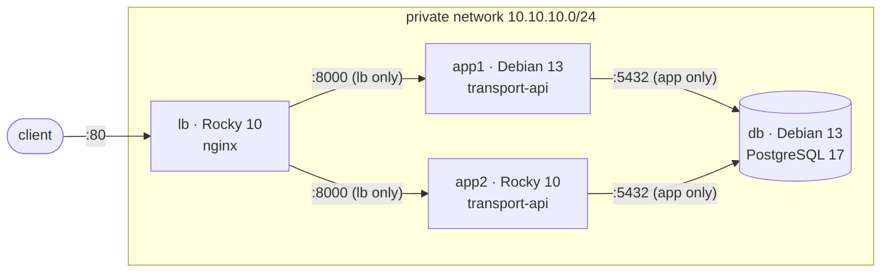
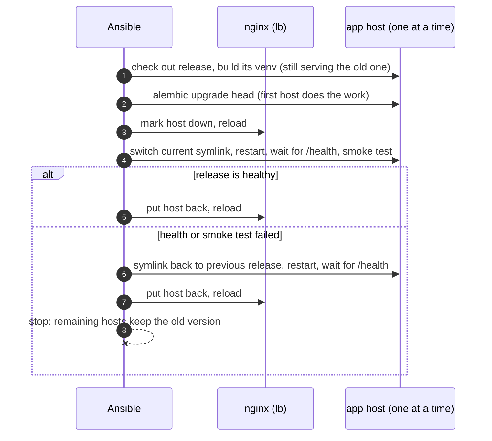

# ansible-infra

[](https://github.com/DYyyyDYyy/ansible-infra/actions/workflows/ci.yml)

A small production setup on four virtual machines, built and updated by Ansible.
`make up` turns empty Debian and Rocky Linux VMs into a hardened stack serving my
[transport-firm REST API](https://github.com/DYyyyDYyy/rest-api-transport-firm)
behind a load balancer. `make deploy` ships a new version one server at a time
without dropping a single request, and rolls back by itself if the new version
is broken.

## What it shows

- **Idempotent configuration management.** A second run of the playbook reports
  `changed=0` on every host; CI fails if it does not.
- **Zero-downtime rolling deploys.** Each app server is drained from nginx,
  switched, health-checked and put back. In the docker lab, 1938 requests
  were sent during a full deploy and none failed.
- **Automatic rollback.** If a new release fails its health or smoke test, the
  host goes back to the previous release and the rollout stops before it
  reaches the other server.
- **Two distro families.** Every role runs on Debian 13 and Rocky Linux 10,
  with SELinux left enforcing on Rocky.
- **Defence in depth.** nftables default-deny with rules derived from the
  inventory, key-only SSH, automatic security updates, secrets in Ansible
  Vault, and a sandboxed systemd service that cannot modify its own code.
- **Tested infrastructure.** Molecule and testinfra for every role on both
  distros, plus end-to-end tests of the whole stack in CI.

## Architecture



| Host | Role(s) | Open ports |
|---|---|---|
| `lb` | `common`, `firewall`, `nginx` | 22, 80 |
| `app1`, `app2` | `common`, `firewall`, `app` | 22, 8000 from `lb` only |
| `db` | `common`, `firewall`, `postgresql` | 22, 5432 from `app*` only |

## Quick start

Requirements: Linux with KVM, `libvirt`, `vagrant` with the `vagrant-libvirt`
plugin, `make`, [`uv`](https://docs.astral.sh/uv/) and about 4 GB of free RAM.
Everything else (ansible-core, collections, linters, Molecule) is pinned and
installed into `.venv` by `make venv`.

```bash
make up                     # 4 VMs + site.yml
curl http://10.10.10.10/health
curl http://10.10.10.10/vehicles

make deploy VERSION=def475af343b98ff25ab5b253d328745f3378a20   # rolling deploy of a commit
make check-idempotence      # re-run site.yml, fail on any change
make zero-downtime          # deploy under load, fail on any non-200 response
make test-rollback          # deploy a release that fails its smoke test
make down
```

No libvirt? The same stack runs in systemd containers:

```bash
make up ENV=docker          # needs only the docker daemon
curl http://127.0.0.1:8080/health
make e2e                    # what CI runs: up, idempotence, zero-downtime, rollback
```

`make help` lists all targets.

## How a deploy works



Details and trade-offs: [ADR 3](docs/adr/0003-rolling-deploy-and-backward-compatible-migrations.md).

## Roles

| Role | What it does |
|---|---|
| [`common`](roles/common) | Base packages, admin users with exclusive SSH keys, sudo (validated with `visudo`), hardened `sshd` drop-in (validated with `sshd -t`), unattended-upgrades or dnf-automatic for security updates |
| [`firewall`](roles/firewall) | nftables default-deny ruleset from variables, checked with `nft -c`, reloaded atomically; masks firewalld on Rocky |
| [`postgresql`](roles/postgresql) | Distro PostgreSQL (17 on Debian, 16 on Rocky), settings in `conf.d/`, templated `pg_hba.conf`, users with SCRAM passwords, databases |
| [`app`](roles/app) | The FastAPI service: release directories with a venv each, `current` symlink, Alembic migrations, systemd unit with sandboxing, health and smoke checks, old release cleanup, rollback tasks |
| [`nginx`](roles/nginx) | Reverse proxy and round-robin load balancer with passive health checks, a shared upstream zone and drainable backends |

The distro differences (package names, PostgreSQL paths and `initdb`, the
nginx user, the nftables config path, SELinux) live in each role's
`vars/<os_family>.yml`; the tasks are shared.

## Testing

| Level | Tool | Where |
|---|---|---|
| Lint | `yamllint`, `ansible-lint` (production profile), `shellcheck` | `make lint` |
| Role | Molecule + testinfra in systemd containers, Debian 13 and Rocky 10, including an idempotence run | `make test`, CI matrix: 5 roles × 2 distros |
| Stack | full `site.yml` on the docker lab, second run must be `changed=0` | `make check-idempotence` |
| Deploy | rolling deploy while `curl` hits the load balancer every 20 ms | `make zero-downtime` |
| Failure | release whose smoke test fails: expect rollback, hosts back in nginx, no failed requests | `make test-rollback` |

Results from local runs (2026-11-10):

| Check | Docker lab | Vagrant VMs (SELinux enforcing) |
|---|---|---|
| Second `site.yml` run | `changed=0` on all 4 hosts | `changed=0` on all 4 hosts |
| Rolling deploy under load | 1938 requests, 0 failed, slowest 94 ms, 0 nginx retries | 1183 requests, 0 failed, slowest 45 ms |
| Failed deploy with rollback | 1116 requests, 0 failed, both hosts on the previous release | 688 requests, 0 failed, both hosts on the previous release |

## Secrets

`make vault-init` generates random secrets for an environment and encrypts them
with Ansible Vault into `inventories/<env>/group_vars/all/vault.yml`, using a
random password in `.vault_pass`. Both files are git-ignored, so every clone
gets its own secrets. In a team you would commit the encrypted file and keep
the vault password in a password manager or CI secret.

## Repository layout

```
├── Makefile, Vagrantfile, ansible.cfg, requirements*.{txt,yml}
├── inventories/
│   ├── vagrant/            VMs, SSH
│   └── docker/             systemd containers, docker exec; also describes the lab
├── playbooks/
│   ├── site.yml            converge every host
│   ├── deploy.yml          rolling deploy with rollback
│   ├── lab.yml             create/remove the docker lab
│   └── group_vars/         topology: firewall and pg_hba rules derived from groups
├── roles/<role>/           tasks, templates, vars/<os_family>.yml, molecule/
├── scripts/                vault-init, idempotence, zero-downtime and rollback checks
├── docs/adr/               why things are the way they are
├── docs/runbooks/          what to do when it breaks
└── .github/workflows/      CI
```

## Design decisions

1. [Configuration management on long-lived servers](docs/adr/0001-configuration-management-on-long-lived-servers.md): mutable vs immutable infrastructure
2. [Release directories and a symlink switch](docs/adr/0002-release-directories-and-symlink-switch.md)
3. [Rolling deploy and backward-compatible migrations](docs/adr/0003-rolling-deploy-and-backward-compatible-migrations.md)
4. [A docker lab next to the Vagrant VMs](docs/adr/0004-docker-lab-next-to-vagrant.md)
5. [One nftables ruleset instead of firewalld or ufw](docs/adr/0005-nftables-role-instead-of-firewalld-or-ufw.md)

Runbooks: [disk full](docs/runbooks/disk-full.md) ·
[PostgreSQL does not start](docs/runbooks/postgresql-does-not-start.md) ·
[failed deploy](docs/runbooks/failed-deploy.md)

## Known limitations

- **One database, one load balancer.** There is no failover for `db` or `lb`;
  the project is about configuration and deploys, not high availability.
- **`/health` does not check the database.** The API only has a liveness
  endpoint so far. `app_health_path` switches to `/health/ready` once the API
  gets one.
- **Config-only changes are not drained.** The drain happens when the release
  changes. Changing only the env file or the unit restarts the service in
  place; nginx retries GETs on the other server, but an in-flight POST could
  fail.
- **Migrations are not rolled back.** A failed deploy keeps the new schema and
  relies on migrations being backward compatible (ADR 3).
- **What the docker lab cannot test:** SELinux, the kernel and boot, SSH as
  the transport, and packages missing from minimal images. Those paths only
  run on the Vagrant VMs (ADR 4).
- **The firewall role flushes the whole ruleset**, so it must not run on hosts
  with Docker, Podman or libvirt.
- **Lab shortcuts:** `host_key_checking = False` in `ansible.cfg` because the
  VMs are recreated often, and privileged containers in the docker lab.
- **Rocky on Vagrant needs three workarounds**, all in the `Vagrantfile`: the
  `rockylinux/10` catalog entry points at an image that no longer exists, so
  the box comes from the Rocky mirror pinned by checksum; its metadata claims
  a 5 GB disk for a 10 GiB image, so the disk size is set explicitly; and
  Vagrant cannot configure networks on EL10 (no ifcfg support), so the
  private address is set with `nmcli`.
- **CI does not run the VMs.** GitHub Actions runs the docker lab; the
  Vagrant path is run by hand before a change is considered done (ADR 4).

## Roadmap

- Backups: restic to MinIO on a separate host, a systemd timer and an
  automatic restore test.
- Monitoring: node_exporter, postgres_exporter, Prometheus, Alertmanager to
  Telegram.
- A runbook for restoring a dropped table from the backup.
